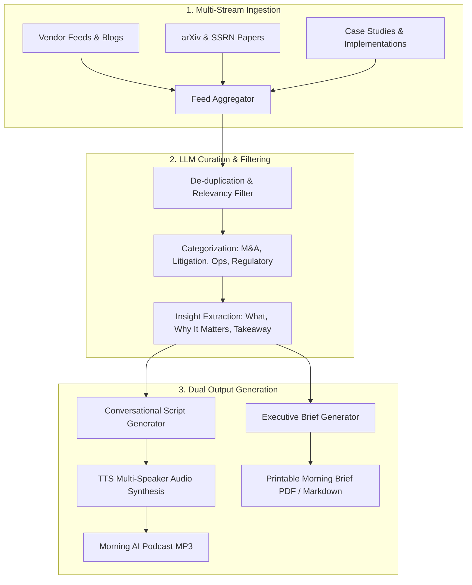

# Legal Tech Market Scanner, AI Podcast & Morning Executive Brief

## 1. Vision & Overview
A standalone application designed to continuously monitor and curate the legal tech and legal AI ecosystem. Operating on a scheduled daily or bi-daily cadence, it scans multiple intelligence streams (vendor product launches, emerging academic papers, and real-world practitioner implementations) and synthesizes the findings into two daily morning deliverables:
1. **An Audio AI Podcast**: A dynamic, conversational multi-speaker dialogue briefing (e.g. host and legal tech specialist) ready for the morning commute.
2. **A Printable Executive Brief**: A high-signal markdown/PDF executive summary highlighting major industry shifts, new tools, and actionable implications.

---

## 2. Intelligence Streams & Data Ingestion
The ingestion engine periodically pulls from three primary channels:

### A. Legal Tech Vendors & Industry Product Releases
* **Tracked Entities**: Emerging legal tech startups, legal LLM providers (e.g., Harvey, Casetext/CoCounsel, Robin AI, Spellbook, EvenUp), and established legal enterprise platforms (LexisNexis, Thomson Reuters, Relativity).
* **Ingestion Channels**: RSS/Atom feeds, product release changelogs, vendor engineering blogs, press releases.

### B. Academic & Applied Research
* **Tracked Repositories**: arXiv (`cs.CL`, `cs.AI`, `cs.CY`), SSRN (Legal Scholarship Network), LawArXiv.
* **Topics**: Legal reasoning benchmarks, synthetic contract evaluation, court opinion prediction, statutory analysis with LLMs, retrieval-augmented generation in legal workflows.

### C. Cool Real-World Implementations & Practice Case Studies
* **Sources**: Law firm tech blogs, legal operations (CLOC) case studies, legal engineering GitHub repositories, and practitioner analysis.
* **Focus**: Practical workflow automation, deployment challenges, prompt architectures, and ROI metrics.

---

## 3. Processing & Synthesis Pipeline

---

## 4. Deliverables

### A. The Morning AI Podcast
* **Dialogue Structure**: 2-host conversational dialogue format breaking down the day's top 3–5 developments in accessible, engaging language with practical commentary.
* **Audio Engine**: Multi-speaker Text-to-Speech (TTS) rendering using modern natural voice synthesis.
* **Audio Export**: Standalone `.mp3` stored in a dedicated daily digest folder or published to a local RSS/podcast feed.

### B. The Printable Executive Brief
* **Structure**:
  1. *Executive Snapshot*: 3-sentence summary of the day's macro themes.
  2. *Top Vendor Moves*: Key feature launches and integrations.
  3. *Key Academic Breakthroughs*: New research papers and their practical significance.
  4. *Implementation of the Day*: A notable legal engineering or firm automation showcase.
  5. *Source References*: Hyperlinked original papers, blogs, and repos.
* **Formats**: Clean Markdown and printable PDF.

---

## 5. Next Steps & Development Roadmap
* [ ] **Phase 1: Ingestion Adapters**: Build modular scrapers for arXiv, SSRN, and vendor RSS feeds.
* [ ] **Phase 2: LLM Curation**: Implement DSPy filtering pipeline for legal relevance scoring and deduplication.
* [ ] **Phase 3: Podcast Scripting & TTS**: Build conversational script prompt generator and TTS audio pipeline.
* [ ] **Phase 4: Executive Brief Generator**: Template PDF/Markdown export.
* [ ] **Phase 5: Scheduling**: Automated daily/bi-daily cron trigger.
