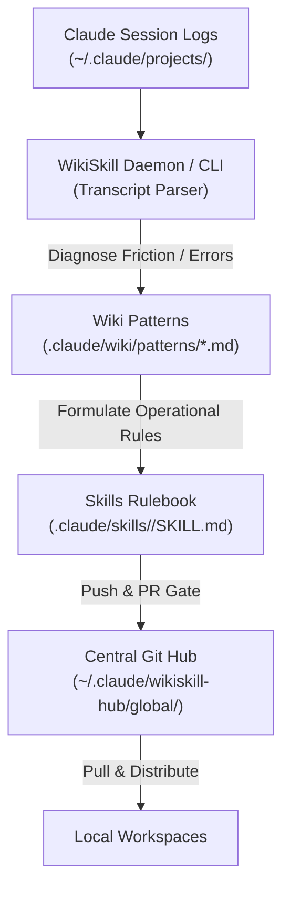

# WikiSkill: Compounding Knowledge & Self-Evolving Skill Harness

`wikiskill` is a distributed, self-evolving knowledge and skill harness designed for Claude Code and Antigravity agent sessions. It inspects session execution transcripts, diagnoses recurring failure patterns, formulates actionable operational rules into Anthropic-style skills, and compounds knowledge across repositories and workstations via a central Git Hub.

---

## Architecture: The Compounding Knowledge Loop



---

## Core Concepts: Patterns vs. Skills

WikiSkill separates **diagnostic observation** from **active policy**:

| Dimension | **Patterns** (`.claude/wiki/patterns/*.md`) | **Skills** (`.claude/skills/<skill>/SKILL.md`) |
| :--- | :--- | :--- |
| **Nature** | **Diagnostic / Empirical** (The *"What went wrong"*) | **Prescriptive / Behavioral** (The *"How to do it right"*) |
| **Role** | Knowledge base recording symptoms, error traces, and root cause analysis. | Operational rules and heuristics loaded directly into Claude's prompt context. |
| **Impact** | Passive documentation; does not alter prompt behavior or introduce prompt bloat. | Active constraints executed during agent tool usage and task workflows. |
| **Review Bar** | **Low**. Factual incident records are rarely rejected and are batched together in combined documentation PRs. | **High**. Active rules undergo human gate review via **isolated candidate PRs per skill**. |
| **Linking** | Declared in `patterns_addressed` frontmatter of the corresponding skill. | Bundles linked pattern files into the skill's proposal PR for reviewer context. |

---

## GitHub CLI Integration & PR Gating Workflow

To prevent uncontrolled modifications to shared engineering practices, `wikiskill` enforces a Pull Request gate:

### 1. Pre-Flight Capability & Interactive Auth (`gh`)
Before creating candidate branches or staging remote commits:
- Checks if the GitHub CLI (`gh`) is installed.
- Verifies authentication (`gh auth status`). If unauthenticated, interactively prompts:
  ```text
  Would you like to run 'gh auth login' now to authenticate? (y/n) [y]:
  ```
- If accepted, launches `gh auth login` directly in your terminal and verifies credentials before proceeding.
- If declined or `gh` is unavailable, offers web-based compare URLs or cleanly aborts with **zero orphan branches created**.

### 2. Isolated PR per Skill + Batched Patterns PR
- **Skill Proposals**: Each modified skill generates a dedicated candidate branch (e.g. `proposal/skill-file-editing-20261004-155110`) containing the `SKILL.md`, `PURPOSE.md`, and any pattern files listed in `patterns_addressed`. A dedicated PR is opened via `gh pr create`.
- **Standalone Patterns**: Observational patterns not attached to a proposed skill are bundled into a single `proposal/patterns-<timestamp>` PR to eliminate PR bloat.

---

## Installation & Setup

Install `wikiskill` directly into your virtual environment:

```bash
# Editable install
uv pip install -e .

# Or run directly via uv / uvx
uv run wikiskill --help
```

---

## CLI Commands Reference

`wikiskill` provides dual CLI entrypoints: `wikiskill` and `wikiskill-harness`.

### 1. `init` — Workspace Scaffolding
Scaffolds `.claude/wiki/` (`index.md`, `logs.md`, `skill-impact.md`, and `patterns/`) and `.claude/skills/` in any target repository.

```bash
uv run wikiskill init [--project-dir <path>]
```

### 2. `post-session` — Post-Session Evolution Loop
Parses the latest Claude Code transcript for the target workspace, extracts failure patterns, updates the wiki, and generates candidate skills.

```bash
uv run wikiskill post-session [options]
# Legacy flag:
uv run wikiskill --post-session
```
- `--since <ISO-timestamp>`: Only process sessions modified at or after timestamp.
- `--dry-run`: Preview updates without writing files.
- `--mock`: Run with synthetic trajectory.
- `-v, --verbose`: Enable debug logs.

### 3. `status` — Status Inspection
Inspects active wiki patterns, evolution logs, and operational skills recognized in the target workspace.

```bash
uv run wikiskill status [--project-dir <path>]
```

### 4. `setup-hub` — Central Hub Configuration
Initializes the central hub repository at `~/.claude/wikiskill-hub` linked to your remote Git repository.

```bash
uv run wikiskill setup-hub --remote https://github.com/your-user/personal-wiki-skills.git
```

### 5. `sync` — Global Hub Synchronization & PR Gate
Synchronizes promoted engineering practices with the central Git Hub, pulls global skills down to the workspace, and creates candidate PRs.

```bash
# Propose universal patterns and skills via isolated candidate PRs
uv run wikiskill sync --push

# Push directly to main (bypassing candidate PR branches)
uv run wikiskill sync --push --direct

# Pull global skills & patterns into workspace
uv run wikiskill sync --pull

# Pull and prune local skills/patterns deleted or rejected upstream
uv run wikiskill sync --pull --prune
```

### 6. `daemon` — Multi-Agent Background Watcher Daemon
Continuously monitors all active agent workspaces (Claude Code projects in `~/.claude/projects/` and Antigravity brain conversations in `~/.gemini/antigravity/brain/`). When a new session completes, the daemon automatically parses the trajectory, runs the evolution loop, and syncs updates to the hub.

```bash
# Continuous background watcher (default interval: 300s)
uv run wikiskill daemon

# Single scan pass across all agent logs and exit
uv run wikiskill daemon --once

# Custom scan interval (e.g. 60s)
uv run wikiskill daemon --interval 60
```

---

## Multi-Agent Log Adapters & Extensibility

WikiSkill uses an extensible Factory pattern (`AgentLogAdapterFactory`) to ingest session transcripts across different AI agent environments:

- **`ClaudeCodeLogAdapter`**: Parses Anthropic turn-based tool invocations and results from `~/.claude/projects/`.
- **`AntigravityLogAdapter`**: Parses Google Antigravity planner steps, tool executions, and errors from `~/.gemini/antigravity/brain/<conv_id>/.system_generated/logs/transcript.jsonl`.
- **Custom Adapters**: Easily extend to Cursor, Codex, or custom agents by subclassing `AgentLogAdapter` and registering with `AgentLogAdapterFactory.register("cursor", CursorLogAdapter)`.

---

## Programmatic Python API

```python
from wikiskill import (
    AgentLogAdapterFactory,
    AntigravityLogAdapter,
    ClaudeCodeLogAdapter,
    GitHubSyncManager,
    WikiSkillDaemon,
    WikiSkillHarness,
)

# 1. Run post-session evolution using auto-detected agent adapter
harness = WikiSkillHarness(project_dir=".")
result = harness.run_post_session()

# 2. Multi-Agent Background Daemon
daemon = WikiSkillDaemon()
processed_sessions = daemon.scan_and_process_sessions()

# 3. Central Hub Synchronization
sync_manager = GitHubSyncManager()
sync_manager.init_hub(remote_url="https://github.com/user/personal-wiki-skills.git")
sync_manager.sync_project_to_hub(project_dir=".", prune=True)
sync_manager.sync_hub_to_project(project_dir=".", prune=True)
```

---

## Test Suite & Verification

The test suite is partitioned into unit tests and end-to-end integration tests:

```bash
# Run full test suite (unit + integration)
uv run pytest -v

# Run unit tests only
uv run pytest tests/unit/ -v

# Run end-to-end integration tests only
uv run pytest tests/integration/ -v

# Run code style & type checks
uv run ruff check .
uv run ruff format --check .
uvx pyrefly check --summarize-errors
```
